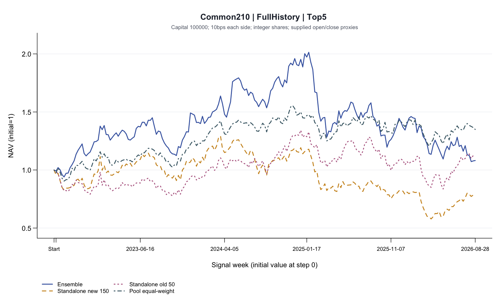
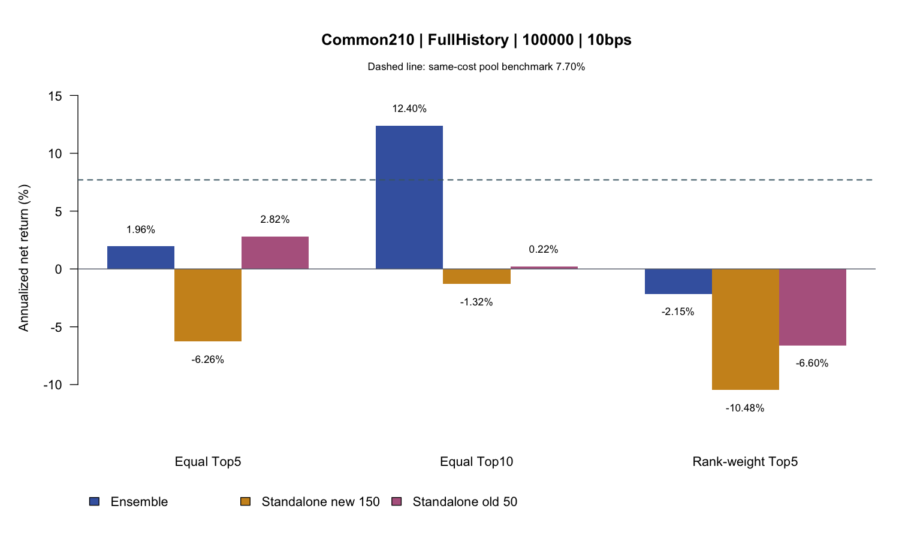
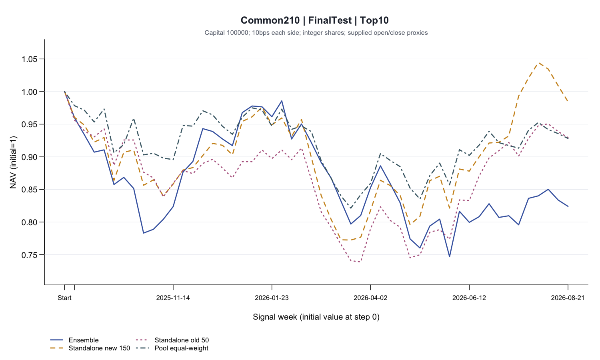
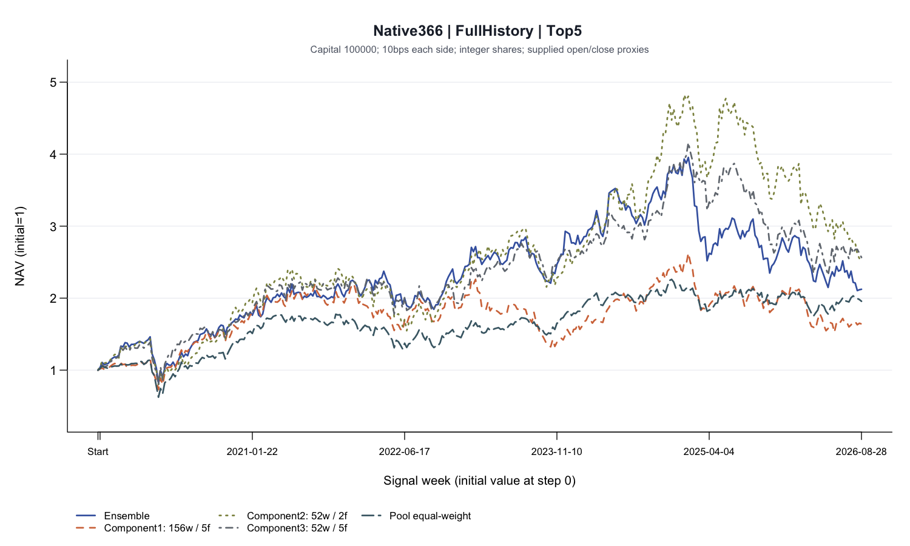
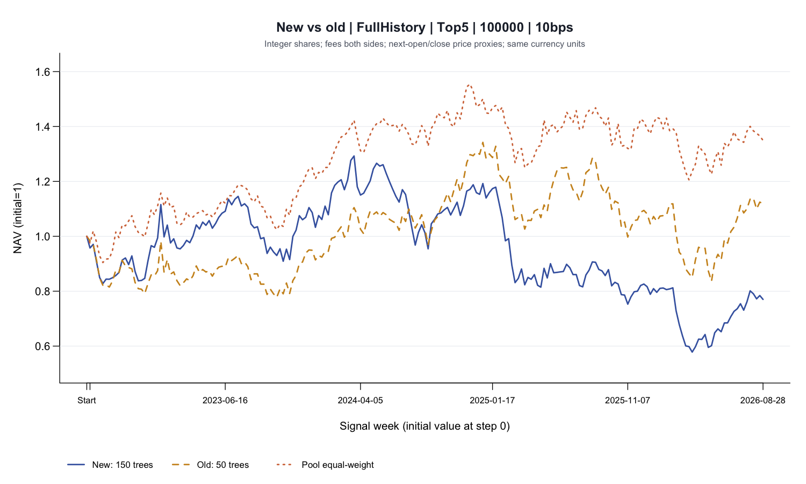
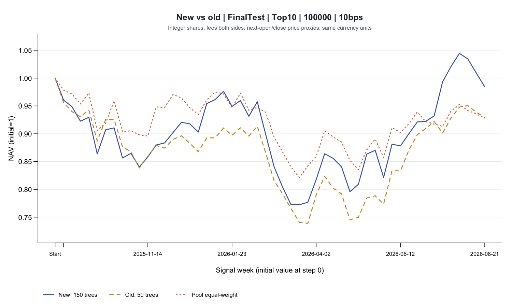
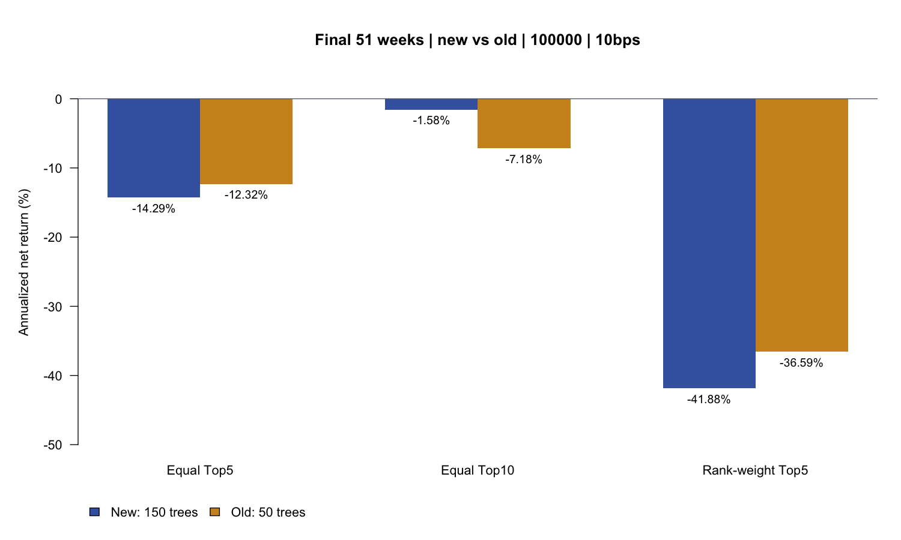

# Ensemble与独立Ranker：完整整数股评估回测

## 完整评估结论

**已补齐Ensemble及三个子模型。** 现在包括等权集成、三个子模型、独立新版150树、独立旧版50树，共六个预测模型；Ensemble是三个子模型百分位分数的等权平均，没有第四套独立训练权重。

**共同210周中，Ensemble的Top10表现较好，但优势没有延续到最终期。** 初始资金10万、单边10bps：Ensemble Top10年化12.40%、Sharpe0.626，独立新版Top10为-1.32%；共同股票池等权为7.70%。最终51周，Ensemble Top10降至-17.90%，Top5为-32.28%。完整期结果不能证明稳定优胜。

**完整历史与公平比较分别报告。** 集成体系保留2019年8月30日至2026年8月28日的366周；六模型比较使用相同8,354个股票周、210周。15种策略、两种对照、1万/10万资金和0/10/25bps均以整数股重新模拟。原两版独立模型的结果保留。

## Ensemble如何构成，哪些文件已补齐

子模型1采用156周训练窗口、五因子；子模型2采用52周、经营盈利能力和债务资产比；子模型3采用52周、五因子并使用更强正则化。五因子为收入增长、经营盈利能力、现金流/资产、负债/资产、资产增长。全部每26周更新；每个子模型先在当周外部股票池内将原始分数转成百分位，再取三者等权均值排序。

**45个保存模型已按各自历史生效区间重新加载，原始分数、百分位和Ensemble排名与交付文件完全一致，最大原始分数误差为0。** 未用最后一期权重倒推过去，也没有重训或改变集成权重。补充包保留45个JSON、完整配置、预测CSV、原机器学习评估、源码、因子定义、训练窗口和价格关联审计。

完整历史每周可用27–40只股票，共同210周为38–40只。所有预测均按日期与股票一对一接到同一价格文件，标签核对通过，没有丢掉2019–2022的预测。两种时间口径的年化不直接混在一起比较。

## 共同210周：比较相同股票、日期和执行规则

下面固定比较等权Top5。Ensemble年化1.96%、Sharpe0.207、最大回撤幅度46.76%；独立新版年化-6.26%。图中股票池等权是同资金、同成本的共同对照。所有窗口从现金、净值1独立开始，不把较早积累的收益带进共同区间。

## 六模型的同一Top5策略

下表增加三个子模型作为拆解对照，股票池等权仅保留一行。模型排序与资金权重属于不同步骤：相同模型改用Top10或排名加权后，收益和风险都会变化，不能由Top5推断所有策略的结果。

### 共同210周、10万、10bps：各模型Top5

| 模型 | 年化收益 | Sharpe | 最大回撤 | 期末资金 |
| --- | --- | --- | --- | --- |
| 独立新版150树 | -6.26% | -0.0992 | -55.27% | 77011.6867 |
| 独立旧版50树 | 2.82% | 0.2368 | -37.69% | 111873.6701 |
| Ensemble等权集成 | 1.96% | 0.2067 | -46.76% | 108154.8763 |
| 子模型1（156周/五因子） | -3.56% | 0.0077 | -41.86% | 86386.4035 |
| 子模型2（52周/两因子） | 9.88% | 0.4717 | -47.06% | 146311.0322 |
| 子模型3（52周/五因子） | 7.15% | 0.3955 | -44.14% | 132170.2368 |
| 共同股票池等权 | 7.70% | 0.4851 | -22.43% | 134924.0816 |

## 策略会改变模型比较的结论

共同210周中，Ensemble Top10的年化为12.40%，高于其Top5的1.96%；Top10使用更多股票，改变了集中度与持仓路径。下面按预先已有的Top5、Top10和排名加权Top5比较三套主要输出，没有按新结果更换规则。

## 最终51周：Ensemble也出现明显亏损

最终期仍采用2025年9月5日至2026年8月21日的51周。Ensemble Top5年化-32.28%、Sharpe-1.173；Top10年化-17.90%、Sharpe-0.603。这段结果说明，完整期较好的策略不能直接作为稳定性的证据。该区间已经查看，不能再当作新的未见测试。

## 15种策略的成对结果

下表完整保留Ensemble与独立新版在共同完整期和最终期的15种主策略，差值为集成年化减去独立新版年化，单位是百分点。正分数过滤对Ensemble等同于不筛选，因为百分位均值为正；它不是剔除未来亏损。过去4/13周亏损过滤、26周波动与趋势仍只用当时可知的价格。全部其他窗口、资金和成本见补充CSV。

### Ensemble与独立新版：15策略×2窗口

| 窗口 | 策略 | 集成年化 | 独立新版年化 | 差值（百分点） |
| --- | --- | --- | --- | --- |
| FullHistory | Top5 | 1.96% | -6.26% | 8.2235 |
| FullHistory | Top10 | 12.40% | -1.32% | 13.7166 |
| FullHistory | Top5_PositiveScore | 1.96% | -6.26% | 8.2235 |
| FullHistory | Top10_PositiveScore | 12.40% | -1.32% | 13.7166 |
| FullHistory | Top5_NoLoss4w | 9.83% | -4.01% | 13.8451 |
| FullHistory | Top10_NoLoss4w | 2.99% | -1.16% | 4.1560 |
| FullHistory | Top5_NoLoss13w | 10.44% | -15.55% | 25.9932 |
| FullHistory | Top10_NoLoss13w | 0.94% | -7.20% | 8.1371 |
| FullHistory | Top5_RankWeighted | -2.15% | -10.48% | 8.3266 |
| FullHistory | Top5_LowVol26w | -1.83% | -5.27% | 3.4433 |
| FullHistory | Top5_RankRisk26w | -3.74% | -9.62% | 5.8706 |
| FullHistory | Top5_Buffer10 | 8.84% | -8.72% | 17.5686 |
| FullHistory | Top5_Rebalance2w | 4.92% | -10.00% | 14.9189 |
| FullHistory | Top5_Rebalance4w | 2.10% | -6.57% | 8.6679 |
| FullHistory | Top5_Trend26w | -4.33% | -8.47% | 4.1446 |
| FinalTest | Top5 | -32.28% | -14.29% | -17.9929 |
| FinalTest | Top10 | -17.90% | -1.58% | -16.3204 |
| FinalTest | Top5_PositiveScore | -32.28% | -14.29% | -17.9929 |
| FinalTest | Top10_PositiveScore | -17.90% | -1.58% | -16.3204 |
| FinalTest | Top5_NoLoss4w | -15.77% | -12.95% | -2.8202 |
| FinalTest | Top10_NoLoss4w | -23.60% | -20.89% | -2.7058 |
| FinalTest | Top5_NoLoss13w | 0.86% | -27.59% | 28.4516 |
| FinalTest | Top10_NoLoss13w | -5.16% | -31.56% | 26.4020 |
| FinalTest | Top5_RankWeighted | -40.57% | -41.88% | 1.3073 |
| FinalTest | Top5_LowVol26w | -31.61% | -13.46% | -18.1480 |
| FinalTest | Top5_RankRisk26w | -38.89% | -37.79% | -1.0982 |
| FinalTest | Top5_Buffer10 | -39.74% | -29.40% | -10.3419 |
| FinalTest | Top5_Rebalance2w | -24.02% | -22.46% | -1.5579 |
| FinalTest | Top5_Rebalance4w | -19.02% | -30.92% | 11.8952 |
| FinalTest | Top5_Trend26w | -39.31% | -12.20% | -27.1152 |

## 2019年开始的366周完整历史单独保留

使用全部13,517条预测，Ensemble Top5年化11.29%、Sharpe0.506，Top10年化11.89%、Sharpe0.555。下面只比较同样拥有366周预测的Ensemble和三个子模型；不把独立模型尚未产生预测的训练期填成投资收益。早期较好的收益可能改变整体结果，因此必须同时查看上面的共同期和最终期。

## 集成体系完整历史指标

这张表只覆盖2019年开始的366周、10万资金、单边10bps等权Top5。它与210周表的历史长度不同；期末资金以及年化差异不能全部归因于集成或独立模型结构。

### 集成体系366周、10万、10bps：Top5

| 模型 | 周数 | 年化收益 | Sharpe | 最大回撤 |
| --- | --- | --- | --- | --- |
| Ensemble等权集成 | 366 | 11.29% | 0.5063 | -46.77% |
| 子模型1（156周/五因子） | 366 | 7.29% | 0.3808 | -41.94% |
| 子模型2（52周/两因子） | 366 | 14.30% | 0.5710 | -47.11% |
| 子模型3（52周/五因子） | 366 | 14.32% | 0.5649 | -44.20% |
| 共同股票池等权 | 366 | 10.00% | 0.4972 | -45.20% |

## 排序评估与交易回报分别解读

下面使用相同210周及最终51周的target1标签计算每周Rank IC，再对周取均值；ICIR是不年化的周IC均值除以样本标准差。交易回报来自买卖价格、整数股和现金，不能用IC替代年化收益。所有六模型的补充NDCG使用同一指数增益定义；原交接包使用sklearn线性增益，数值可能不同，原定义和原指标已保留在source目录，不能混为一个指标。

### 六模型在共同样本的排序质量

| 模型 | 窗口 | 平均Rank IC | ICIR | 正IC周比例 |
| --- | --- | --- | --- | --- |
| 独立新版150树 | FullHistory | 0.0062 | 0.0358 | 51.43% |
| 独立新版150树 | FinalTest | 0.0267 | 0.1600 | 50.98% |
| 独立旧版50树 | FullHistory | 0.0199 | 0.1200 | 50.00% |
| 独立旧版50树 | FinalTest | 0.0504 | 0.2856 | 58.82% |
| Ensemble等权集成 | FullHistory | 0.0171 | 0.0954 | 52.38% |
| Ensemble等权集成 | FinalTest | 0.0340 | 0.2029 | 54.90% |
| 子模型1（156周/五因子） | FullHistory | 0.0171 | 0.0997 | 52.38% |
| 子模型1（156周/五因子） | FinalTest | 0.0325 | 0.1947 | 54.90% |
| 子模型2（52周/两因子） | FullHistory | 0.0079 | 0.0454 | 50.95% |
| 子模型2（52周/两因子） | FinalTest | -0.0066 | -0.0419 | 47.06% |
| 子模型3（52周/五因子） | FullHistory | 0.0220 | 0.1231 | 53.33% |
| 子模型3（52周/五因子） | FinalTest | 0.0540 | 0.3342 | 56.86% |

## 补充回测已核验，原独立模型结果保留

新增Ensemble及三个子模型的两种时间口径，共12,648个情景，加上原两版2,856个情景，总计15,504个；其中共同样本8,568个、集成体系完整历史6,936个。调仓相位敏感性合计1,080组。它们包含重叠窗口，并非独立重复实验。

新增2,224,700笔10bps交易和2,466,904条持仓已经逐笔核对，并从现金流与股数重建开盘、收盘资金；全部指标独立复算，48组周末清仓参考与交付模拟一致。股数都是整数，现金不透支，新增最大金额算术误差约7.42e-10。原两版结果文件保持不变。

限制仍然适用：价格是交付开收盘代理，没有独立验证复权、公司行动、实际成交、滑点与因子披露时点。下面保留原两版独立模型的完整分析、策略表及窗口结果，作为补充对照。

## 原独立两版比较（保留）

**本次已完成新旧两版对比。** 最新model_only交接包为150棵树，之前独立模型为50棵树；两版均为五因子XGBRanker。两版使用相同40只外部股票、8,354条预测和210个信号周（2022年8月26日至2026年8月28日）。

**新版没有表现出全面改进。** 初始资金100,000、单边10bps时，完整期等权Top5：新版年化−6.26%、Sharpe−0.10，旧版年化2.82%、Sharpe0.24。共同股票池等权对照年化7.70%，两版Top5都落后于对照。

**最后51周两版15种主策略均为负年化。** 新版Top10年化−1.58%，较旧版−7.18%损失小；新版排名加权Top5年化−41.88%，旧版−36.59%。增加树数并未在所有策略、时间窗口中产生一致改善，不据此认定新版稳定优于旧版。

## 版本、样本与预测评估

新旧模型都使用收入增长、经营盈利能力、现金流/资产、负债/资产、资产增长五因子，输入先按每周横截面转换为百分位排名。训练股票池共66只，与外部40只不重叠；使用312周训练窗口，每26周更新一次。两版深度均为2，最小子节点权重均为5；新版150树，旧版50树。

新版直接加载9个已保存模型，重放排名与交付结果完全一致，最大分数差约5.71×10⁻⁹。旧版按冻结50树参数重跑9次滚动拟合，8,354条分数与上次冻结预测逐条完全一致；未重新选参。日期与股票键逐条一致，价格取同一份输入。

原始外部数据从2015年9月开始，但它不等于有预测的交易区间。312周训练历史及交付模型的首个更新日期决定本次只能从2022年8月26日回测；没有把训练期补成样本外投资收益。

模型排序质量使用target1下一周收盘到收盘对数收益标签；交易收益使用另列buy_price/sell_price，两者分别评估。完整期平均Rank IC：新版0.0062，旧版0.0199；最后51周分别0.0267、0.0504。数值为逐周Spearman相关的均值，靠近0表示整体排序关系较弱；不能直接解释为收益率。

### 两版排序质量：完整期与最终期

| 版本 | 窗口 | 周数 | 平均Rank IC | ICIR | 正IC周比例 | NDCG@5 |
| --- | --- | --- | --- | --- | --- | --- |
| 新版150树 | FullHistory | 210 | 0.006 | 0.036 | 51.43% | 0.343 |
| 新版150树 | FinalTest | 51 | 0.027 | 0.160 | 50.98% | 0.342 |
| 旧版50树 | FullHistory | 210 | 0.020 | 0.120 | 50.00% | 0.339 |
| 旧版50树 | FinalTest | 51 | 0.050 | 0.286 | 58.82% | 0.356 |

## 整数股执行与指标口径

每个窗口从全现金独立重跑。主情景100,000，另做10,000敏感性分析；资金单位与股票报价相同，不做外汇换算，也不标为AUD。每笔交易取整股数，现金保留，不融资、不购买小数股。

目标股数=floor(目标权重×开盘资产÷[买价×(1+买入费率)])。先卖出超出目标的股数，再依固定排名顺序买入；现金不足继续向下取整，余额不重新分配。分配2,000、股价300时买6股，零费用剩200；10bps买入后剩198.20，若原价卖出，最终1,996.40。

使用下一周首交易日开盘价代理调仓、下一周末收盘价代理估值，连续持股包含跨周价格变化。不调仓周保留实际股数，窗口末全部卖出计费。买卖双方按实际成交额各收费；0/10/25bps均重新模拟，费用会改变可买股数。

年化收益=(期末/期初)^(52/周数)−1；年化波动=周净收益样本标准差×√52；Sharpe=周净收益均值/样本标准差×√52，无风险利率0；最大回撤从初始资金开始计算。负复利年化与微正算术Sharpe可能同时出现。

## 完整210周：旧版Top5的结果较好

新版Top5期末资金77,011.69，最大回撤55.27%；旧版111,873.67，最大回撤37.69%。下图固定比较同一Top5策略，第三条线是相同整数股及成本规则的股票池等权。各线从净值1开始，首个日期点是初始资金标记，横轴主体为信号周。完整期更好并不意味着旧版能够在未来持续获利。

下表保留两版全部15种主策略和2种对照。股票池等权在两版行中完全相同，它是共同基准，不是第三个学习模型。

### 完整期各版本、各策略指标

| 版本 | 策略 | 年化收益 | Sharpe | 最大回撤 |
| --- | --- | --- | --- | --- |
| 新版150树 | 等权Top5 | -6.26% | -0.099 | -55.27% |
| 新版150树 | 等权Top10 | -1.32% | 0.064 | -44.35% |
| 新版150树 | 正分数Top5 | -6.26% | -0.099 | -55.27% |
| 新版150树 | 正分数Top10 | -1.32% | 0.064 | -44.35% |
| 新版150树 | Top5过去4周非亏损 | -4.01% | -0.013 | -52.09% |
| 新版150树 | Top10过去4周非亏损 | -1.16% | 0.057 | -43.13% |
| 新版150树 | Top5过去13周非亏损 | -15.55% | -0.571 | -60.65% |
| 新版150树 | Top10过去13周非亏损 | -7.20% | -0.255 | -53.00% |
| 新版150树 | 排名加权Top5 | -10.48% | -0.210 | -65.44% |
| 新版150树 | 低波动Top5 | -5.27% | -0.085 | -55.85% |
| 新版150树 | 排名风险Top5 | -9.62% | -0.210 | -64.48% |
| 新版150树 | 前10保留缓冲 | -8.72% | -0.202 | -54.41% |
| 新版150树 | 2周调仓Top5 | -10.00% | -0.235 | -58.16% |
| 新版150树 | 4周调仓Top5 | -6.57% | -0.107 | -57.42% |
| 新版150树 | 趋势过滤Top5 | -8.47% | -0.298 | -52.34% |
| 新版150树 | 股票池等权对照 | 7.70% | 0.485 | -22.43% |
| 新版150树 | 每周清仓Top5对照 | -14.38% | -0.454 | -61.44% |
| 旧版50树 | 等权Top5 | 2.82% | 0.237 | -37.69% |
| 旧版50树 | 等权Top10 | 0.22% | 0.116 | -38.64% |
| 旧版50树 | 正分数Top5 | 2.82% | 0.237 | -37.69% |
| 旧版50树 | 正分数Top10 | 0.22% | 0.116 | -38.64% |
| 旧版50树 | Top5过去4周非亏损 | 1.71% | 0.188 | -41.17% |
| 旧版50树 | Top10过去4周非亏损 | -1.50% | 0.025 | -41.13% |
| 旧版50树 | Top5过去13周非亏损 | -8.26% | -0.265 | -54.17% |
| 旧版50树 | Top10过去13周非亏损 | 1.40% | 0.168 | -39.08% |
| 旧版50树 | 排名加权Top5 | -6.60% | -0.087 | -58.34% |
| 旧版50树 | 低波动Top5 | 5.15% | 0.327 | -33.16% |
| 旧版50树 | 排名风险Top5 | -4.18% | -0.017 | -55.22% |
| 旧版50树 | 前10保留缓冲 | -0.52% | 0.105 | -36.32% |
| 旧版50树 | 2周调仓Top5 | 5.37% | 0.331 | -37.78% |
| 旧版50树 | 4周调仓Top5 | 3.40% | 0.259 | -46.28% |
| 旧版50树 | 趋势过滤Top5 | -1.12% | 0.051 | -28.41% |
| 旧版50树 | 股票池等权对照 | 7.70% | 0.485 | -22.43% |
| 旧版50树 | 每周清仓Top5对照 | -6.96% | -0.161 | -39.24% |

## 最后51周：改善取决于策略

最终期采用2025年9月5日至2026年8月21日，共51个信号周。Top5新版年化−14.29%、旧版−12.32%，两版均亏损。下面的Top10曲线用于展示策略差异：新版−1.58%、旧版−7.18%，共同对照−7.32%；这并不能抵消完整期Top5的退步。

下面按固定的等权Top5、等权Top10和排名加权Top5比较最终期年化。三组均包含负值；排名加权将更多资金集中在前列股票，本次最终期使两版损失扩大，不能把排名高当作确定收益高。

完整表中两版15种主策略均为负年化。正分数过滤与Top5/Top10在这些样本中相同；Ranker正分数不等于预期回报为正，不能把该规则解释为提前识别未来亏损。

### 最终期各版本、各策略指标

| 版本 | 策略 | 年化收益 | Sharpe | 最大回撤 |
| --- | --- | --- | --- | --- |
| 新版150树 | 等权Top5 | -14.29% | -0.449 | -36.59% |
| 新版150树 | 等权Top10 | -1.58% | 0.066 | -22.76% |
| 新版150树 | 正分数Top5 | -14.29% | -0.449 | -36.59% |
| 新版150树 | 正分数Top10 | -1.58% | 0.066 | -22.76% |
| 新版150树 | Top5过去4周非亏损 | -12.95% | -0.289 | -35.84% |
| 新版150树 | Top10过去4周非亏损 | -20.89% | -0.843 | -34.20% |
| 新版150树 | Top5过去13周非亏损 | -27.59% | -1.303 | -33.44% |
| 新版150树 | Top10过去13周非亏损 | -31.56% | -1.477 | -35.70% |
| 新版150树 | 排名加权Top5 | -41.88% | -1.524 | -51.81% |
| 新版150树 | 低波动Top5 | -13.46% | -0.493 | -31.87% |
| 新版150树 | 排名风险Top5 | -37.79% | -1.496 | -47.21% |
| 新版150树 | 前10保留缓冲 | -29.40% | -1.211 | -31.51% |
| 新版150树 | 2周调仓Top5 | -22.46% | -0.814 | -39.78% |
| 新版150树 | 4周调仓Top5 | -30.92% | -1.202 | -40.61% |
| 新版150树 | 趋势过滤Top5 | -12.20% | -0.657 | -23.10% |
| 新版150树 | 股票池等权对照 | -7.32% | -0.269 | -17.86% |
| 新版150树 | 每周清仓Top5对照 | -23.28% | -0.934 | -37.59% |
| 旧版50树 | 等权Top5 | -12.32% | -0.296 | -34.56% |
| 旧版50树 | 等权Top10 | -7.18% | -0.213 | -26.10% |
| 旧版50树 | 正分数Top5 | -12.32% | -0.296 | -34.56% |
| 旧版50树 | 正分数Top10 | -7.18% | -0.213 | -26.10% |
| 旧版50树 | Top5过去4周非亏损 | -14.77% | -0.582 | -32.37% |
| 旧版50树 | Top10过去4周非亏损 | -27.77% | -1.364 | -37.15% |
| 旧版50树 | Top5过去13周非亏损 | -20.17% | -0.944 | -35.12% |
| 旧版50树 | Top10过去13周非亏损 | -13.80% | -0.592 | -24.76% |
| 旧版50树 | 排名加权Top5 | -36.59% | -1.080 | -53.15% |
| 旧版50树 | 低波动Top5 | -3.90% | -0.007 | -28.17% |
| 旧版50树 | 排名风险Top5 | -30.56% | -0.904 | -48.90% |
| 旧版50树 | 前10保留缓冲 | -26.55% | -0.976 | -41.30% |
| 旧版50树 | 2周调仓Top5 | -5.90% | -0.053 | -36.27% |
| 旧版50树 | 4周调仓Top5 | -25.26% | -0.784 | -43.18% |
| 旧版50树 | 趋势过滤Top5 | -16.66% | -0.826 | -27.39% |
| 旧版50树 | 股票池等权对照 | -7.32% | -0.269 | -17.86% |
| 旧版50树 | 每周清仓Top5对照 | -19.56% | -0.610 | -34.26% |

## 策略规则与不同窗口

15种主策略为：等权Top5/Top10、正分数Top5/Top10、过去4周非亏损Top5/Top10、过去13周非亏损Top5/Top10、排名加权Top5、低波动Top5、排名风险Top5、前10保留缓冲、每2周调仓、每4周调仓、26周趋势过滤。另有股票池等权和原脚本每周清仓Top5两种对照。

排名加权按5:4:3:2:1分配；低波动按过去26周波动率倒数分配，排名风险再乘排名权重，两类风险加权单股上限35%。亏损过滤只看过去4/13周已知价格变化；趋势过滤在过去26周等权指数高于其均线时参与。缺少合格股票的预算保留现金。缓冲策略保留仍在前10的持仓，再补足5只，按周调整目标股数。

2/4周策略在非调仓周保留实际股数，包含跨周跳空；每个窗口重新初始化计时。原交付模拟则每周开盘买、周末全卖，周末持现金，两类执行暴露不同，因此分开展示。两版共12组资金/费用的每周清仓路径均与交付模拟函数一致。

14个窗口包含完整期、最近13/26/52/104/156周、2022至2026各自然年、Development、Validation和Final Test。自然年首末可能不完整，最近窗口彼此重叠；不能把这些结果当成独立重复验证。

### 两版Top5各窗口指标：10万、10bps

| 版本 | 窗口 | 周数 | 年化收益 | Sharpe | 最大回撤 |
| --- | --- | --- | --- | --- | --- |
| 新版150树 | FullHistory | 210 | -6.26% | -0.099 | -55.27% |
| 新版150树 | Last13w | 13 | 94.58% | 3.391 | -3.87% |
| 新版150树 | Last26w | 26 | 34.36% | 1.251 | -13.05% |
| 新版150树 | Last52w | 52 | -15.49% | -0.508 | -36.59% |
| 新版150树 | Last104w | 104 | -10.47% | -0.273 | -51.47% |
| 新版150树 | Last156w | 156 | -8.18% | -0.177 | -55.24% |
| 新版150树 | Year2022 | 19 | -22.88% | -0.798 | -17.24% |
| 新版150树 | Year2023 | 52 | 12.55% | 0.557 | -20.63% |
| 新版150树 | Year2024 | 52 | 15.38% | 0.679 | -26.15% |
| 新版150树 | Year2025 | 52 | -34.50% | -1.414 | -37.42% |
| 新版150树 | Year2026 | 35 | -3.64% | 0.010 | -28.84% |
| 新版150树 | Development | 105 | -0.44% | 0.121 | -26.21% |
| 新版150树 | Validation | 52 | -5.93% | -0.079 | -31.66% |
| 新版150树 | FinalTest | 51 | -14.29% | -0.449 | -36.59% |
| 旧版50树 | FullHistory | 210 | 2.82% | 0.237 | -37.69% |
| 旧版50树 | Last13w | 13 | 124.97% | 3.681 | -3.46% |
| 旧版50树 | Last26w | 26 | 45.45% | 1.401 | -12.89% |
| 旧版50树 | Last52w | 52 | -12.47% | -0.308 | -34.56% |
| 旧版50树 | Last104w | 104 | 7.08% | 0.390 | -37.73% |
| 旧版50树 | Last156w | 156 | 10.49% | 0.519 | -37.67% |
| 旧版50树 | Year2022 | 19 | -40.58% | -1.988 | -20.88% |
| 旧版50树 | Year2023 | 52 | 9.51% | 0.471 | -20.77% |
| 旧版50树 | Year2024 | 52 | 44.93% | 1.820 | -12.15% |
| 旧版50树 | Year2025 | 52 | -22.78% | -0.885 | -26.22% |
| 旧版50树 | Year2026 | 35 | 10.42% | 0.474 | -25.21% |
| 旧版50树 | Development | 105 | -1.06% | 0.082 | -21.44% |
| 旧版50树 | Validation | 52 | 30.11% | 1.216 | -23.53% |
| 旧版50树 | FinalTest | 51 | -12.32% | -0.296 | -34.56% |

## 敏感性与可复核范围

共完成2版×17规则×14窗口×2资金×3费用=2,856组情景，其中主策略2,520组、两种对照336组。另有2/4周调仓在完整期、验证期和最终期的216组相位情景；主结果采用固定相位0，没有挑最优起点。

按订单独立重建全部10bps资金路径，并核查所有情景的年化收益、Sharpe和回撤。4,160,178项数值核对通过，最大资金算术误差约1.89e-09；股数全部为整数，现金不透支。加入旧版后，新版原有1,428组结果保持不变。386张PNG包含两版各窗口分组策略图、逐策略新旧对比及回撤图；完整逐周数据可自行重新绘图。

10,000资金不能简单由100,000结果缩放，因为整股约束改变持仓。两版在每个资金与费用情景分别重算，共同股票池对照的资金路径完全一致。

## 结论边界与后续验证

这些是基于交付数据的历史模拟。买卖价为文件定义的开收盘代理，尚未独立确认复权、分红拆股、成交可得性和最后一行的实际交易日期；费用情景不涵盖真实滑点、冲击成本与容量。每周可用38–40只外部股票，股票池选择与存活偏差仍可能影响解释。

历史标签收益与实际价差存在定义差异，本报告没有混用。所有过滤只使用信号时已知的前序价格；但是否满足真实披露时点，还取决于原五因子数据的发布时间定义。Final Test结果已被查看，只作为固定历史区间，不能继续称为未见测试。

**当前证据支持保留两版对照并继续验证，不能认定新版普遍更优。** 下一步应先确认代理价格与公司行动，再冻结模型及策略，在未查看的新时间段做前推模拟；重点观察Top5/Top10的基准超额、回撤及费用敏感性，避免根据本次结果反复调整参数后仍称样本外。