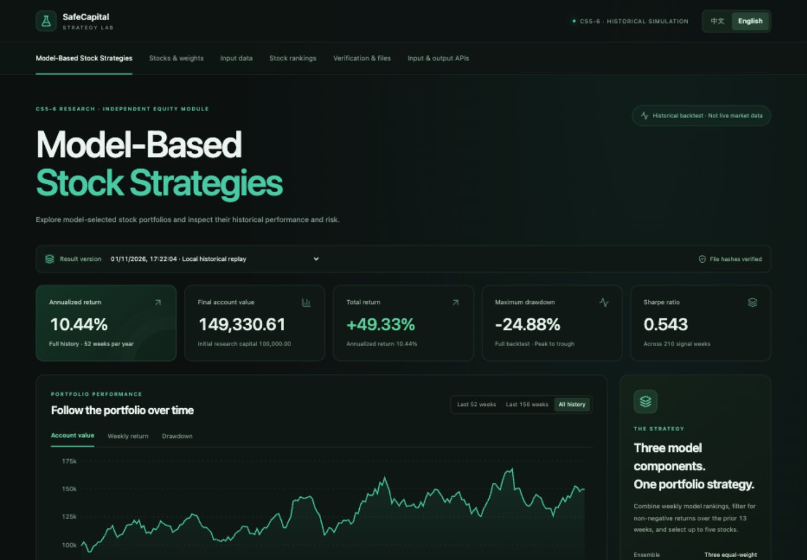
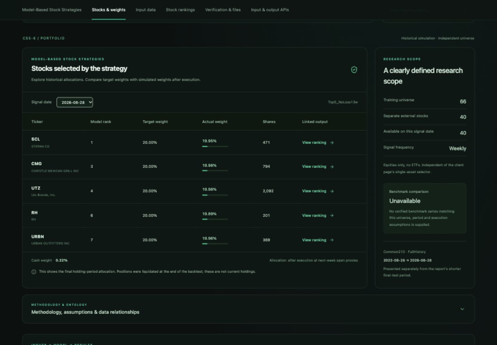
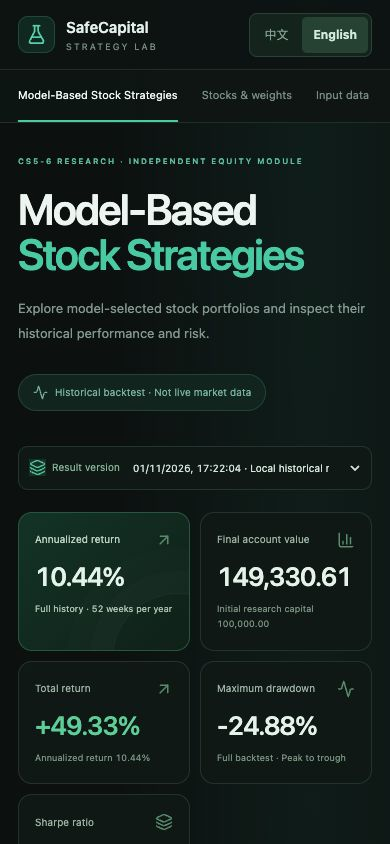
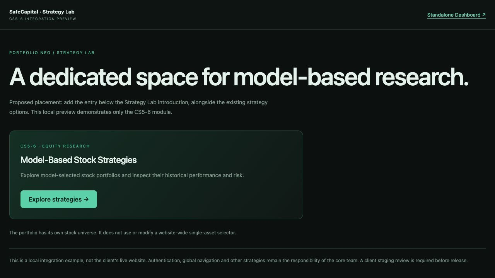

# Portfolio Neo 模块验收记录 — 2026-11-01

版本：1.3.0；分支：`feature/cs5-6-portfolio-neo-integration`。范围为本项目本地模块和接入示例，不是客户实际站点验收。

## 已完成

- 后端测试：`python -m unittest discover -s dashboard/tests -v`，**39/39 通过**。包括已有 API/输入身份绑定/下载/跨域策略，以及本次持仓合同、66/40 范围、选股不等于排名前五、全部周权重求和、缺失快照隔离、篡改拒绝、无数据/无效日期/未知运行。
- 前端：TypeScript 检查 + Vite 生产构建通过；Node 六项双语测试通过，文案覆盖新增 PortfolioPanel。
- HTTP 示例：`node dashboard/examples/verify-module.mjs` 通过，成功 200、无数据 200/no_data、无效日期 422/error、未知运行 404/error。
- 离线持仓导出：两种已保存结果序列化各一份快照，每份 **210 周**；原始每周资金/收益/现金/费用等 8 列最大误差 **0**；每份独立账户核验 **9586 项**，最大误差 **2.842170943040401e-14**。这里只复算已有保存预测的执行过程，没有训练模型或生成新预测。
- 与任务开始时提交的发布清单比较：**207 个非 Dashboard 文件哈希一致**，原始模型、数据、报告、预测与回测保持原值。
- 浏览器：1440×1000 桌面、390×844 手机，页面无整体横向溢出；宽表在自己的容器内横向滚动。
- 浏览器真实操作：英文/中文切换；持仓从 2026-08-28 切到 2022-08-26；首次日期选股 PLAY/CROX/LW/SBUX/BJ；点击 PLAY 联动到对应日期排名；切语言保留所选持仓日期；方法说明展开；独立入口卡片展开/收起 iframe；iframe 内切换中文，示例外壳同步中文。
- 缺失基准与币种使用 unavailable/null，并提供原因；数据集中没有独立财务发布时间戳，不将信号日期声称为发布时间。

## 结果口径

`Common210 / FullHistory`：2022-08-26 至 2026-08-28，初始资金 100000，期末资金 149330.60888418998，累计收益 0.49330608884189986，年化 0.1043902627962429，最大回撤 −0.24878123919912354，Sharpe 0.5434211006497096。年化采用每年 52 周的复合公式；与报告的较短 final-test 分开。

最后持有期的选股为 SCL、CMG、UTZ、RH、URBN，模型排名 1/3/4/6/7，目标各 20%；实际权重由整数股与现金计算，现金约 0.22496%。期末已清仓，此表不是当前持仓。

## 截图

桌面：

真实持仓与范围：

手机英文：

客户入口提案（本地外壳）：

## 待客户环境验收

实际 Portfolio Neo 入口落位、客户认证、全局路由、其他团队模块与本体、客户域名跨域配置、服务停止后的整站表现、客户部署及生产发布均未执行。需要客户仓库/测试环境，由核心团队审核。Docker 运行与公网部署继续暂缓。

测试环境出现 Starlette 对现有 httpx 测试适配器的弃用提示，以及旧输入测试的文件句柄 ResourceWarning；不影响本次通过结果，未为此升级已锁定运行依赖。
